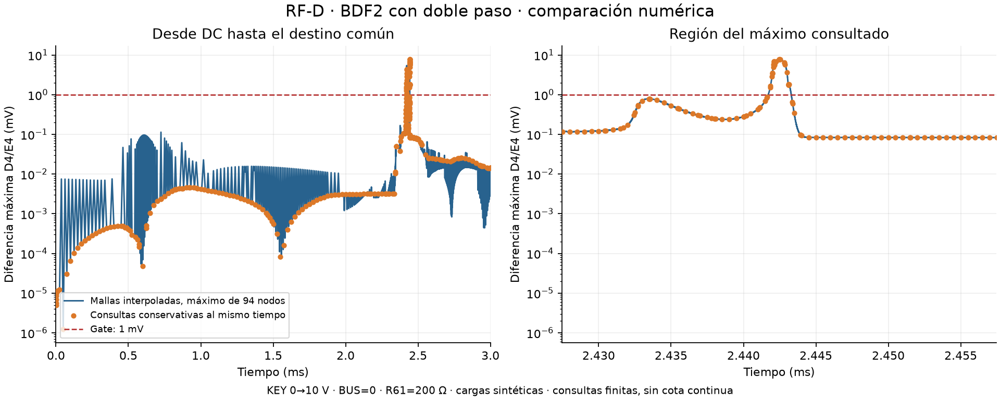

# Barrido desde DC con estimador BDF2 de doble paso

## Experimento declarado antes de medir

El [prototipo v4](BIESTABLE_ESTIMADOR_BDF2_DOBLE_PASO.md) se integra en
un controlador nuevo, sin modificar los productores ni los datos anteriores.
Se conserva el circuito documental condicionado de 94 nodos, R61=200 Ω,
BUS=0, perfil sintético `finite_transit`, DC con KEY=0 y salto a KEY=10
en t=0. Destino: 3 ms. No se reinicia la memoria durante el barrido.

| Política | Absoluta nodo/juntura | Relativa nodo/juntura | Incremento de juntura | h·λ+ | Intentos |
| --- | --- | --- | --- | --- | --- |
| D4 | 40 nV | 4×10⁻⁸ | 25 mV | 0,05 | 6000 |
| E4 | 10 nV | 1×10⁻⁸ | 12,5 mV | 0,025 | 12000 |

Las tolerancias son decisiones de experimento numérico, no constantes del
instrumento. Las sondas previas tienen diferencias crudas de hasta 0,684 µV;
este barrido pregunta por acumulación global, que esas sondas no acotan.
Ambas políticas usan máximo 100 µs, mínimo real 1 ps y razón BDF2 ≤2.
El macro requiere ≥2 ps para que sus dos medias etapas estén dentro del
dominio. Si el resto al destino no lo permite, se conserva el fallo;
no se redondea el reloj. No se modifica una política después de medirla.

## Arranque, publicación y rechazo

Sólo mientras falta el historial previo se usa el arranque explícito:
BE completo frente a BE medio + BDF2 medio. Los dos intervalos finos se
publican si pasan los gates. Después se usa exclusivamente el estimador v4,
con KEY constante y ambos historiales aceptados. No hay retorno a BE ante
un fallo, selección alternativa de raíces ni clipping.

Cada intento normal compara un BDF2 completo con dos medios BDF2 desde
los mismos estados entrantes. El segundo medio alcanza exactamente el
tiempo binario del completo. La diferencia cruda se escala por voltajes;
no hay división Richardson. Se publica sólo el candidato completo y se
guardan ambas medias etapas como provisionales.

La razón por componente es `|Vfull−Vfine| / [atol + rtol·max(|Vfull|,|Vfine|)]`,
usando pares compensados. Se exige máximo ≤1 para nodos y para junturas.
La tolerancia absoluta de la tabla no es un límite uniforme por componente:
también participa el término relativo, ni implica el gate global de 1 mV.

Para el cúbico exacto del prototipo con h/k=1, el error del **completo**
dividido por la diferencia entre rutas es 32/19. El 13/19 corresponde al
error de la ruta fina. Ninguno de esos factores es una calibración del
DAE: importa también cuál de los candidatos se publica.

Las tres rutas conservan cargas compensadas, C10 serie y cargas terminales
Q25/Q15. Sus publicaciones se verifican desde historiales reales con
Decimal80: KCL <10 pA, ecuación de rama <10 fV y restauración exacta.
El residuo del solve y su corrección conservan los gates anteriores.
El control local incluye incremento de juntura y modos congelados de las
tres rutas. Un rechazo conserva el hash de ambos historiales entrantes.

El crecimiento usa la heurística anterior: máximo de razones de error <0,25,
incremento y producto modal por debajo de la mitad de sus gates, luego
duplica h dentro del dominio. Esto no garantiza aceptar la propuesta nueva.
Por ejemplo, para el cúbico con historiales exactos, razón h/k=2 y escala
absoluta fija, la diferencia entre rutas es proporcional a h³. Otra
duplicación con historiales exactos y razón 2 multiplica esa diferencia
por 8. Una regresión más concreta conserva el candidato realmente publicado:
y=t³ en tiempos 0/−0,5, h=1; completo=19/10 y diferencia=23/45.
Con escala absoluta fija que normaliza esa diferencia a 0,2, el siguiente
h=2 parte de 19/10 y 0, no de la curva exacta. Da diferencia=992/225,
razón normalizada=992/575≈1,725 y por tanto rechazo. La recurrencia se
verifica con fracciones exactas. Es un contraejemplo a interpretar 0,25
como garantía de crecimiento, no una explicación exhaustiva de los rechazos
del circuito ni una cota global. Se conserva la regla declarada; otro
controlador requerirá un experimento propio.

## Comparación y observación

Gate global original: **máximo <1 mV en cualquiera de los 94 nodos**, al
mismo reloj, además de cobertura completa. La diferencia final no sustituye
el máximo. El primer contraste interpola linealmente las mallas aceptadas,
excluyendo los puentes iniciales del salto de fuente. También se conserva
el contraste de cada nueva política con C3, sin identificar una como exacta.

La selección de consultas se fija por regla antes de medir sus valores:
rejilla de 25 µs en 0..3 ms, rejilla de 0,5 µs en 2,4..2,5 ms,
32 puntos medios estratificados por política y el máximo interpolado de
cada uno de los 94 nodos. Se añade el máximo interpolado global.
El observador conserva el tiempo pedido con el dominio de 1 ps y, cuando
corresponde, dos intervalos provisionales desde un anclaje anterior.
Se repiten con Jacobiano totalmente FD los picos interpolado y consultado.
Un conjunto finito de consultas no prueba el máximo continuo.

## Reproducción y archivos

`python tools/loudness_latch_bdf_doubling_survey.py`

`python tools/loudness_latch_bdf_doubling_sampling.py`

`python -m unittest discover -s tests -p test_loudness_latch_bdf_doubling_survey.py -v`

`python -m unittest discover -s tests -p test_loudness_latch_bdf_doubling_sampling.py -v`

Los dos casos se guardan por separado en
`evidence/loudness_latch_bdf_doubling_d4.json.gz` y
`evidence/loudness_latch_bdf_doubling_e4.json.gz`, con resumen
`evidence/loudness_latch_bdf_doubling_survey_summary.json`.
La observación tiene su propio gzip y resumen `...doubling_sampling...`.
Compresión sin pérdida, JSON canónico, SHA256 de fuentes/datos antes y
después, ambiente y serialización completa. Separar casos limita el tamaño
de archivo sin eliminar memorias o rechazos.

Las políticas y productores quedaron publicados en `fd991fc` antes de
cerrar los resultados. El barrido había comenzado desde la base `dc4b040`,
que figura en `environment.git_head`; ese campo no identifica por sí solo
los archivos nuevos. Los hashes `source_sha256` fijan sus bytes y se
verifican al terminar. La observación se ejecuta sobre los casos guardados
y registra su propia revisión y hashes.

Figura opcional, derivada sólo de los datos guardados:

`python -m pip install --no-deps --target artifacts/plot-libs -r requirements-plot.txt`

`python tools/plot_bdf_doubling.py`

Sus dependencias se aíslan del solver. La figura y su metadata identifican
las entradas y distinguen la envolvente interpolada de las consultas finitas.

## Resultados del barrido

Ambas políticas alcanzan exactamente 3 ms, dentro de sus presupuestos:

| Política | Intentos aceptados | Intervalos publicados | Medios provisionales aceptados | Rechazos | KCL máxima publicada/provisional |
| --- | --- | --- | --- | --- | --- |
| D4 | 3523 | 3524 | 7044 | 315 | 9,96405 / 9,86386 pA |
| E4 | 5921 | 5922 | 11840 | 669 | 9,96542 / 9,98226 pA |

Total: **9446 intervalos publicados** y **18884 medios provisionales
aceptados**. Cada caso tiene un solo arranque mixto de dos intervalos:
uno BE y uno BDF2. Los demás candidatos publicados son BDF2 completos.
Los 984 rechazos tienen razón `voltage-error-or-junction-increment`;
ninguno agotó el presupuesto de solve, paso mínimo o intentos. Los medios
conservados de rechazos se cuentan aparte de la tabla.

Ambas políticas llegan a mínimo publicado **190,73486328125 ps** y
mínimo provisional **95,36743139984538 ps**, por encima de 1 ps.
Los gzip ocupan 43,137168 MB y 73,184281 MB respectivamente; conservan
las memorias y se verifican mediante JSON canónico y SHA256.

La unión de mallas, desde **0,390625 µs** hasta 3 ms, tiene 9434 tiempos.
Máximo D4/E4: **7,808515562 mV**, nodo 66 ATTACK_GATE_LOWER, en
**2,4424715042115066 ms**. Diferencia final: **14,538244756 µV**.
El gate de 1 mV **falla** y `temporal_refinement_admitted=false`.

Los contrastes interpolados conservados con C3 también fallan: D4/C3
**53,893775631 mV** y E4/C3 **50,256929127 mV**, ambos en ATTACK_OUT.
Al final son 11,460697534 µV y 3,077547222 µV. Empiezan en 6,25 µs,
por la primera muestra C3; no cubren el puente inicial anterior.
No indican cuál trayectoria es exacta y no incluyen consultas
conservativas de los máximos de esos pares con C3.

## Consultas conservativas y FD

La selección declarada produce **433 tiempos y 866/866 consultas válidas**,
incluyendo los máximos interpolados de los 94 nodos. Hay 86 consultas
desde un anclaje anterior, con sus dos memorias provisionales, para
evitar restos menores que 1 ps sin cambiar el reloj.

Máximo consultado: **7,808513473 mV** en el mismo nodo 66 y tiempo
**2,4424715042115066 ms**. La diferencia con el máximo interpolado es
aproximadamente 2,09 nV. El gate muestreado de 1 mV también **falla**;
este pico no se explica por la interpolación.

El prefijo hasta 2,3 ms tiene **117/117 tiempos válidos**, máximo
**4,614801144 µV** en TRIGGER_COLLECTOR a 0,925 ms. Pasa sólo ese gate
muestreado; no aporta una cota continua ni admite la transición completa.
La mayor diferencia interpolación/consulta de cada ruta es 1,229465546 mV
en D4 y 0,328112477 mV en E4, ambas a 2,4185 ms. Son diagnósticos de
observación distintos del máximo entre trayectorias.

Los picos interpolado y consultado coinciden. El informe conserva cuatro
registros FD, **dos casos distintos repetidos bajo ambos nombres de pico**.
Todos pasan 10 nV y KCL; diferencia máxima frente al Jacobiano híbrido
**3,108624469×10⁻¹⁵ V**. FD contrasta el solve/Jacobiano, no constituye
un oráculo espacial independiente del circuito.

Los cruces interpolados E4−D4 se separan **+1,715312440 ns** para
ATTACK_OUT subiendo por 4 V y **+1,412009477 ns** para RESET_COLLECTOR
bajando por 0,5 V. Se mantienen sus intervalos y pendientes originales;
no se alinean las trazas para aprobar el gate.

La figura deriva de los archivos guardados. Su metadata fija sus entradas,
NumPy/Matplotlib y el piso de dibujo logarítmico de 10⁻⁹ mV para ceros;
ese piso no modifica datos ni gates.

## Regresiones y siguiente gate

Siete regresiones del barrido comprueban cada publicación principal y
provisional aceptada, los medios conservados de rechazos, linaje de
ambos historiales, arranque único, decisiones locales, reproducción de
aceptaciones/rechazos, comparación global, bytes/hashes y el contraejemplo
exacto de crecimiento. Cinco regresiones de observación comprueban la
selección completa, cada consulta válida, las repeticiones FD, alcance y
almacenamiento.

La primera suite de observación pasó cuatro pruebas y falló una comparación
FD por igualdad Python entre tuplas vivas y listas restauradas de JSON.
Los cuatro replays tienen **bytes JSON canónicos idénticos** a sus registros;
la corrección compara esos bytes y conserva los gates numéricos. El fallo,
SHA256 y código original de la prueba quedan en
`evidence/loudness_latch_bdf_doubling_validation_attempts.json`.
Los informes numéricos y sus hashes permanecen iguales.

Resultado final: **7/7 pruebas del barrido pasan** (191,136 s) y
**5/5 de observación pasan** (17,682 s), el 2026-10-01. Los tiempos
pertenecen a las suites offline, sin admisión de plazo de audio.

El siguiente corte debe examinar acumulación temporal y control del
crecimiento con la memoria publicada, conservando el gate de 1 mV y estos
informes. La coincidencia local de FD y el prefijo muestreado no cierran
el máximo regenerativo. Otro controlador o tolerancia tendrá política,
presupuesto e informe propios antes de promoción al motor nativo.

## Alcance

Este experimento comparte solver espacial y parámetros sintéticos con los
anteriores. No identifica una población vintage, cargas omitidas ni audio.
El resultado de refinamiento pertenece a su política y observación;
no demuestra error absoluto continuo ni habilita el contorno en Rust.
