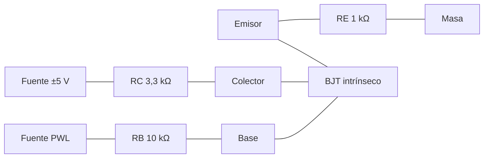

# BJT cargado: cierre temporal condicionado

## Circuito y estado

Continúa el [BJT intrínseco conservativo](BJT_INTRINSECO_CARGA_CONSERVATIVA.md) con un laboratorio independiente de **tres incógnitas B/C/E**, sin fuentes que impongan sus voltajes. Resistencias sintéticas: RB=10 kΩ, RC=3,3 kΩ, RE=1 kΩ; alimentación 5 V para NPN, −5 V para el espejo PNP. No es una transcripción del biestable Model D ni una identificación de sus tiempos.



La PWL del laboratorio tiene tiempos en ns y niveles NPN en V: `(0,0)`, `(50,0)`, `(70,3)`, `(1000,3)`, `(1020,0)`, `(2000,0)`. PNP invierte los niveles y la alimentación. Parámetros de junturas/transporte son los sintéticos ya contrastados: perfiles TF/TR=0/0 y 1/3 ns. No hay capacitor extra, reset de carga ni lógica de etapas.

La KCL usa corriente saliente del BJT más `(Vterminal−Vfuente)/R`. Se prepara un punto DC y sus QBE/QBC; cada paso de Euler hacia atrás resuelve **los tres nodos y ambas cargas** con el mismo historial entrante. Newton usa Jacobiano analítico, line search y puertas `KCL<10⁻¹² A` y corrección `<10⁻⁹ V`. El candidato sólo se publica después de aceptar el paso; rechazo o presupuesto agotado conservan el estado anterior. Todos los parámetros quedan ligados al historial.

Fuentes ejecutables: `tools/bjt_loaded_transient_reference.py` y `tools/bjt_loaded_transient_probes.py`. Informe reproducible: [bjt_loaded_transient_probes.json](../evidence/bjt_loaded_transient_probes.json). Entorno Python 3.12.10/NumPy 2.5.2, binary64; hashes completos en el informe. El oráculo usa NG46-WIN64 registrado en [FUENTES](FUENTES.md).

## Comparación temporal independiente

Se ejecutan **cuatro escenas** (NPN/PNP × dos perfiles), con pasos propios `2/1/0,5/0,25/0,125/0,0625 ns`: **252.000 pasos aceptados**. ngspice integra por separado con `method=gear`, `maxord=1` (Euler hacia atrás adaptable), TEMP/TNOM=25 °C, gmin=0, reltol=10⁻⁶, abstol=10⁻¹⁴ A, vntol=10⁻⁹ V y trtol=7. Se mantiene la correspondencia térmica explícita del bloque anterior; no se cambian los parámetros físicos para mejorar el acuerdo.

La comparación tiene 501 instantes comunes cada 4 ns en 0..2 µs. Los puntos propios pertenecen a pasos aceptados, sin interpolación de esos historiales; los de ngspice se interpolan linealmente desde su malla. El último estudio independiente usa máximos de paso `0,0078125/0,00390625 ns`, verifica tiempos crecientes, alcance final y máximo intervalo efectivo. Los exports completos quedan comprimidos `.txt.gz` en el laboratorio ignorado, junto con netlists/logs y hashes del texto original.

Gates fijados antes del primer barrido, conservados tras los rechazos:

- Ruta propia frente al oráculo fino: **≤2 mV** máximos por nodo en los puntos comparados.
- Refinamiento entre las dos mallas independientes: **≤200 µV** por nodo.
- Error de la malla propia fina / error de la gruesa: **≤0,3**.
- KCL/corrección de voltaje: las mismas puertas de cada solve.

| Perfil, mismo resultado en NPN/PNP | Error propio a 2 ns | Error propio a 0,0625 ns | Refinamiento independiente |
| --- | ---: | ---: | ---: |
| TF/TR=0/0 | 45,1663 mV | **1,3493 mV** | **116,589 µV** |
| TF/TR=1/3 ns | 40,9596 mV | **1,2006 mV** | **126,522 µV** |

El error baja en cada reducción del paso entre las seis mallas. Se atraviesan regiones con ambas junturas directamente polarizadas, y después recuperación bajo la caída PWL. Ninguna de las 252.000 memorias se resetea. Los voltajes PNP son el espejo exacto de NPN; las cargas orientadas coinciden. El máximo KCL registrado es **9,997×10⁻¹³ A**, dentro de la puerta original. Las corrientes de carga permiten excursiones fuera de las fuentes; no se recortan al rango de alimentación.

Estos resultados son **observaciones en una malla**, no una cota uniforme entre puntos ni evidencia sonora vintage. La recuperación no se fuerza a cero al final: la carga remanente queda guardada.

## Intentos que no pasaron

1. ngspice con reltol=10⁻¹⁰, abstol=10⁻¹⁶ A, vntol=10⁻¹² V y trtol=1 abortó a 90,128 ns por `timestep too small`. Devolvió exit code **0** y un export parcial de 547.739 filas. Se rechazó por no cubrir el tiempo final; después se añade inspección explícita de errores/aborto. No se adjudica una causa física a ese fallo.
2. El primer barrido de 60.000 pasos, final propio 0,25 ns y oráculo 0,25/0,125 ns, superó el gate: errores 5,369/4,725 mV y refinamiento independiente 1,232/1,205 mV. Se refinan ambas rutas manteniendo límites.
3. El barrido de 252.000 pasos con oráculo 0,015625/0,0078125 ns pasó el gate propio, pero el independiente dio 216,209/235,419 µV, superiores a 200 µV. Se refina nuevamente el oráculo y se conserva este rechazo en el informe.

El gate rechaza informes vacíos, escenas incompletas o umbrales modificados. Que un programa devuelva éxito no basta para admitir su trayectoria.

## Exportación de carga inicial

En estas corridas, ngspice exporta los campos QBE/QBC de dispositivo como cero en `t=0`, aunque el punto DC tiene BC inversa y QBC referenciada a Q(0)=0 no es cero. Se conservan esos valores originales, marcados `initial_charge_export_valid=false`. **No se usan como historial ni como comparación de carga inicial.**

Los voltajes se comparan incluyendo t=0; la diferencia informativa entre cargas exportadas se calcula sólo para t>0 y no es un nuevo gate de fidelidad. La carga propia inicial procede de su punto DC y ley conservativa. Esta limitación del export no se oculta reemplazándolo por una carga calculada por nuestra referencia.

## Regresión y siguiente cierre

Seis pruebas regeneran métricas desde ambas trazas, reconstruyen todos los pasos de un intervalo guardados en la malla fina, verifican KCL y Q, reproducen veinte pasos con Jacobiano FD desde el mismo historial, comprueban el espejo PNP y los rechazos de presupuesto/malla, y conservan los intentos fallidos. No requieren el binario para revisar los exports; la regeneración completa sí verifica su SHA.

```powershell
python tools/bjt_loaded_transient_probes.py --ngspice references-local/ngspice46/runtime/Spice64/bin/ngspice_con.exe
python -m unittest discover -s tests -p test_bjt_loaded_transient.py -v
```

Siguiente cierre: añadir estas memorias condicionadas a una sonda explícita del biestable, preparar cargas desde su circuito, seguir una trayectoria por continuidad y contrastar cada refinamiento. Debe declararse qué junturas siguen sin dinámica y qué efectos de transporte faltan. No se elige una de las tres raíces antiguas por Newton. El circuito cargado de un solo BJT no admite la conmutación del contorno ni la voz RF-D.
