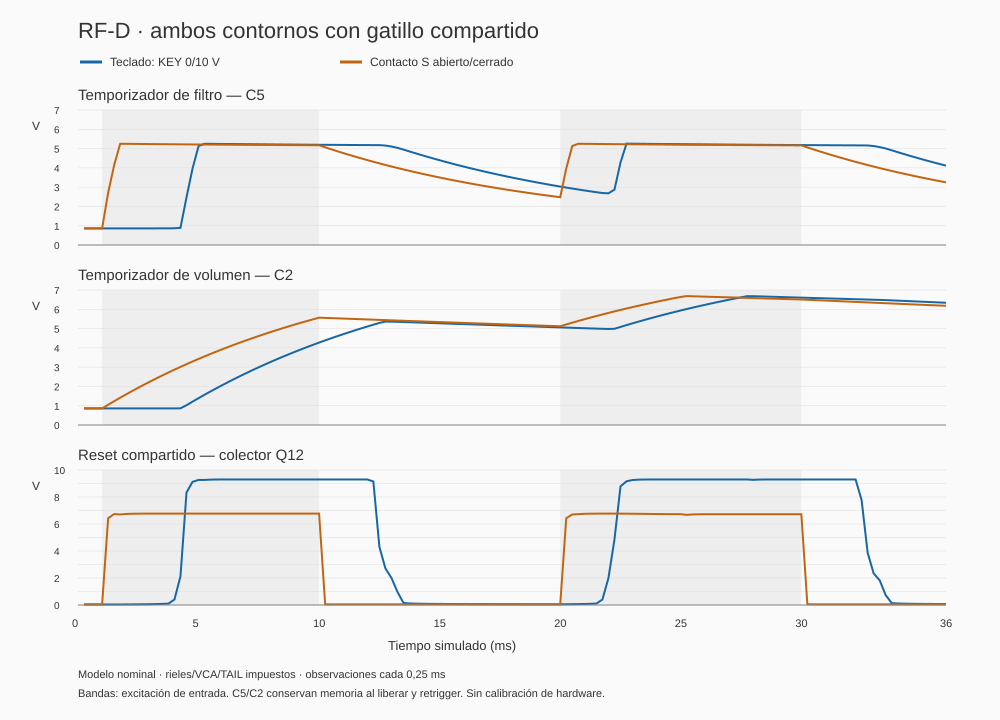

# C5 continuo y gatillo cargado por ambos contornos

2026-10-14. [Protocolo](C5_GATILLO_COMPARTIDO_PROTOCOLO.md), perfil clásico
CA3046 documental, parámetros nominales sin identificación de hardware.
[Revisión de pines y cargas](../evidence/c5_trigger_review01.json).

## Cierre funcional

El núcleo de laboratorio tiene 54 nodos: volumen/gatillo, seguidor de filtro
Q22/Q21 con Amount/Q26/Q28, y temporizador/biestable/sustain del filtro.
C5 deja de ser una fuente impuesta. Q5 lo carga por R1/R12; Q7 lo descarga
por R15; R48/Q22 toman corriente del mismo nodo. CR3, Q1 y Q4 cierran el
biestable eléctrico, sin un selector digital de fase ADSR.

Q12/Q20 existen una sola vez y reciben ambos contornos. R32 y R37 añaden
los pull-ups del filtro, R26/C1 disparan Q1, R35/CR1 llegan a Q4 y CR2
retorna desde sustain al colector Q12. El seguidor no hereda la topología
NPN/NPN de volumen. C12 opcional queda ubicado en paralelo con R50:
corrección de la descripción de frontera anterior, conservada por identidad.

Memoria: C5/C2, C1/C4/C7, C8/C18, C11/C12 opcionales y seis BJTs de
biestable/gatillo con la ley nominal de carga BE/BC previa. Radau IIA de
dos etapas, incrementos y estado high/low compensados. Historia anterior
fija; candidatos no publican; el controlador admite dos medios pasos sólo
después de contrastarlos con el paso completo. Eventos cambian fuentes y
contactos, conservando la memoria capacitiva.

## Banco completo admitido

[native02](../evidence/c5_trigger_native02.json) completa ocho recorridos:
dos recetas C11/C12 (0/0 y 47/500 pF), teclado/S-trigger separados y máximos
de paso 8/4 µs. Cada recorrido comienza en su propio DC, dura 36 ms e
incluye liberación y segundo gatillo. Las resistencias de panel y Amount
permanecen en la escena fija declarada; el API nativo todavía expone sólo
KEY, S-trigger y receta opcional. No acredita un barrido completo de controles.

86228 Accepted nuevos y 172456 medios pasos, 124 replays locales completos,
32 eventos con memoria conservada y 32 rechazos atómicos. Los perfiles
tardaron 8,7–13,3 s cada uno en laboratorio: ese tiempo de simulación de
36 ms no es una admisión de tiempo real.

[Referencia independiente](../evidence/c5_trigger_reference01.json): monta
55 nodos con el cursor Amount explícito, el grafo original de volumen y
las adiciones revisadas del filtro. DC por Newton FD. En las etapas
seleccionadas reconstruye KCL y cargas con Decimal65 y calcula Jacobianos
FD con historia fija. El contraste suma 40920 filas originales y 1469664
entradas FD; no reejecuta ni contabiliza las ecuaciones antiguas de la voz.

| Comprobación | Máximo | Gate |
|---|---:|---:|
| KCL original en etapas seleccionadas | 0,9131 pA | 20 pA |
| Corrección Newton original | 1,3924 nV | 2 nV |
| Fracción de gate FD | 0,006375 | 1 |
| Fracción de gate de nodos entre 8/4 µs | 0,024895 | 1 |
| Fracción de gate de corrientes entre 8/4 µs | 0,000374 | 1 |
| Balance de cargas e integral de corrientes | 1,980×10⁻¹⁶ C | 20 pA × 36 ms |

Se contrastan los 54 nodos y nueve puertos en 144 clocks comunes por par,
576 comparaciones de reloj en total. Gates de nodos 20 µV + 2e−6·|V|;
puertos 2 nA + 2e−5·|I|; FD 2 nS + 2e−5·|referencia|. Observaciones
finitas y etapas seleccionadas, sin afirmar una cota continua del modelo.

## Respuesta observable

[Datos y procedencia](../evidence/c5_trigger_observation01.json), sin
normalización, eliminación de DC ni cambios en las trazas. Máximos de
GRID cada 0,25 ms; no representan máximos continuos entre observaciones.
Ejemplo, receta sin opcionales, resolución máxima 4 µs:

| Observación de C5 | Teclado | S-trigger |
|---|---:|---:|
| DC de reposo | 0,860557 V | 0,860557 V |
| Máximo observado del primer ataque | 5,248994 V | 5,249413 V |
| Antes del segundo gatillo, 20 ms | 3,030201 V | 2,478624 V |
| Segundo periodo activo, 30 ms | 5,181215 V | 5,164334 V |

El segundo ataque parte de la tensión residual. C2 también conserva
memoria. KEY y S-trigger tienen recorridos eléctricos distintos y no se
obligan a producir historias idénticas. En la hipótesis de R60=100 kΩ/C7,
el generador de teclado tarda en cambiar Q12 y retiene su conducción tras
retirar KEY. El contacto S actúa por R49. Son observaciones de este modelo,
no tiempos identificados de un Minimoog real.

El primer auditor suponía que C2 debía caer inmediatamente desde el valor
en el instante de liberar la fuente. Su [fallo y replay](../evidence/c5_trigger_reference_failure01.json)
quedan preservados. [Reparación](../evidence/c5_trigger_reference_repair01.json):
medir decay desde el máximo efectivamente alcanzado antes del siguiente
gatillo, conservando la disminución exigida de 0,1 V. Mismos datos nativos,
leyes y gates numéricos. R60 tiene el conflicto documental previo sin resolver.

## Restore, alcance y próximo paso

[Checkpoint RFDC5011](../evidence/c5_trigger_checkpoint01.json), 904 bytes:
108 f64 de estado, clock, propuesta y controles/receta. 40 estados GRID
restaurados producen por bits el mismo avance que su estado tipado, incluidas
etapas, incrementos y errores. 320 corrupciones se rechazan. La propuesta
de reinicio es explícita; esos avances locales no prolongan la traza original.

Se conservan también el fallo de importación del primer llamador y su replay.
La visualización requirió una alternativa SVG porque matplotlib no estaba
disponible; intentos y reparación quedan registrados, sin instalar paquetes
ni modificar el modelo. [QA global](../evidence/c5_trigger_tests01.json).

Rieles, TAIL del ladder y base VCA siguen impuestos; C5 y Q4 ya son internos.
La voz anterior de 229 estados, sus WAV y biblioteca permanecen intactos.
El viejo estrés de un salto ideal C5 0,85→3 V sigue rechazado: no sustituir
su resultado por este circuito continuo. No hay todavía nuevo audio, plugin
tocable, calibración vintage o medición de heap/deadline. El bloque nuevo
queda fuera de lib.rs y de la voz hasta su admisión de integración.

Próximo cierre: conectar los puertos de filtro y volumen a sus cargas de
placa 4 y medir una voz funcional. Usar este circuito detallado como referencia
para reducir el costo conservando la reacción de cargas y memoria; evitar
otra cadena de certificados locales que postergue la función audible.
